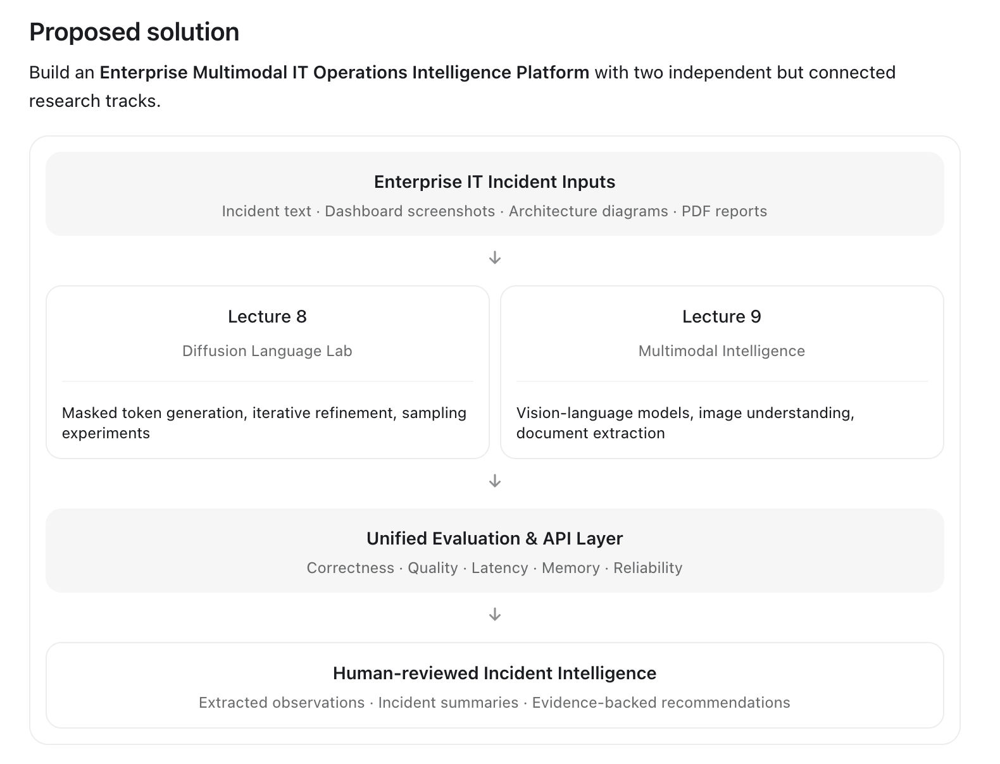

# Enterprise-Diffusion-Multimodal-AI-Engineering
An enterprise-oriented AI engineering platform exploring diffusion language models, masked and iterative generation, multimodal document intelligence, vision-language architectures, model evaluation, and inference performance through modular implementations and reproducible experiments.
# Project overview
  Attribute	Recommendation
  Repository	Enterprise_Diffusion_Multimodal_AI
  Project type	Applied AI architecture and engineering research
  Lecture 8	Diffusion Language Models
  Lecture 9	Multimodal AI & Emerging Architectures
  Primary language	Python
  ML framework	PyTorch
  Model ecosystem	Hugging Face Transformers / Diffusers where applicable
  API	FastAPI
  Testing	pytest
  Deployment	Docker / Colima
  Hardware	Apple Silicon, 8 GB unified memory
  Implementation	Small-model, experiment-driven

# Enterprise problem statement
  Enterprise applications increasingly need to understand information across multiple formats: text, images, screenshots, documents, diagrams, and operational reports.
  Traditional text-only LLM workflows have limitations when important information is contained in visual content. 
  Meanwhile, diffusion-based language modeling offers a different approach to generating and refining text compared with conventional left-to-right autoregressive decoding.



## Running the application

Run these commands from the repository root with Python 3.11 or newer:

```bash
python3 -m venv .venv
.venv/bin/python -m pip install -r requirements-dev.txt
.venv/bin/python -m pytest -q
.venv/bin/python -m uvicorn api.main:app --host 127.0.0.1 --port 8000
```

The interactive API is available at `http://127.0.0.1:8000/docs`. `python scripts/live_lab.py` exercises the running incident endpoint with controlled changes in report text. `docker build -t enterprise-diffusion-multimodal-ai .` builds the API image where Docker or Colima is available.

## Lecture 8 — Diffusion language models

Run `python experiments/lecture_08/01_diffusion_basics.py` through `06_benchmark.py`. The experiments cover Gaussian forward noise, absorbing token masks, masked reconstruction, training a tiny log-linear denoiser, confidence-based iterative unmasking, and comparison with an add-one-smoothed autoregressive bigram model. The core experiments use only the Python standard library. They do not train a continuous reverse process or a PyTorch transformer.

CLI examples:

```bash
python -m cli.main noise
python -m cli.main train --epochs 20
python -m cli.main generate --steps 4 --length 8 --prefix the pump
python -m cli.main benchmark --output reports/lecture_08.json
```

The benchmark uses 96 synthetic training sentences and 32 held-out combinations. It records masked reconstruction accuracy, token error rate, cross entropy, generated samples, latency, Python traced peak memory, and actual generation iterations. See [Lecture 8 notes](docs/lecture_08.md) and the generated [report](reports/lecture_08.json).

Run `python experiments/lecture_08/07_masked_baseline_sweep.py` for a paired reconstruction comparison with a position-frequency masked baseline across three masking ratios, four reverse iteration counts, and three seeds. Results are in [the sweep report](reports/lecture_08_sweep.json).

API endpoints: `POST /diffusion/mask`, `POST /diffusion/generate`, `POST /diffusion/baseline`, and `GET /diffusion/benchmark`.

## Lecture 9 — Multimodal AI

Run `python experiments/lecture_09/01_image_embeddings.py` through `05_benchmark.py`. The default path uses small PPM dashboard tiles and a text incident note. It measures RGB features and color-text similarity, exercises a deterministic mock VLM, extracts UTF-8 and embedded PDF text, combines source-linked evidence, and evaluates incident scenarios. PNG/JPEG and PDF support use Pillow and pypdf. OCR additionally requires pytesseract and a Tesseract executable.

For actual local VLM inference, install `.[local-vlm]`, place a compatible image-text-to-text model in a local directory, and run `python experiments/lecture_09/02_vision_language.py --model-path /path/to/model`. The local model is optional and is not downloaded by the application. The default mock reports pixel statistics and does not identify objects or hazards.

The reproducible small-model lab downloads the [SmolVLM-256M-Instruct](https://huggingface.co/HuggingFaceTB/SmolVLM-256M-Instruct) snapshot to a Git-ignored directory, then probes four dashboard screenshots:

```bash
.venv/bin/python -m pip install '.[local-vlm]'
.venv/bin/python scripts/prepare_local_model.py
.venv/bin/python experiments/lecture_09/06_real_vlm_benchmark.py \
  --model-path data/models/smolvlm-256m-instruct
```

The 38-case synthetic incident dataset is in `data/evaluation/incidents.jsonl`. The default benchmark records each mismatch and evaluates source extraction, evidence links, error handling, and input-size performance. It includes historical, resolved, recurring, active, and conflicting clock-time reports. Model descriptions are kept as **unverified observations**; they do not set incident severity automatically.

On the verified CPU lab run, the optional model recognized the target status word in 3 of 4 synthetic dashboards and took about 105–109 seconds per image. See the [VLM report](reports/lecture_09_vlm.json). It is too slow for a responsive API on this machine without a faster runtime or smaller workload.

`python scripts/generate_dashboard_matrix.py` creates 24 varied dashboard fixtures. `python experiments/lecture_09/07_dashboard_matrix.py --model-path data/models/smolvlm-256m-instruct` measures exact status and numeric reading extraction. `python scripts/reliability_lab.py` exercises a running mock API under repeated and concurrent requests and records server resident memory. These experiments use synthetic images; their labels do not count as independent human ground truth.

The selected 20-image CPU benchmark found the full status value in 4/20 answers and the full numeric reading in 6/20, for **25% exact field accuracy** across 40 fields and 10% with both fields correct. Mean latency was about 123 seconds per image. This fails the 90% acceptance target; see the [dashboard matrix report](reports/lecture_09_dashboard_matrix.json) for each raw answer and layout group.

`POST /multimodal/analyze` accepts JSON with `text`, optional base64 `image_base64`, optional base64 `document_base64` plus `document_name`, and optional `backend`. For `backend: "local"`, set `LOCAL_VLM_MODEL_PATH` on the server. Example:

```bash
curl -X POST http://127.0.0.1:8000/multimodal/analyze \
  -H 'Content-Type: application/json' \
  -d '{"text":"Pressure alarm at pump"}'
```

The scenario report measures severity accuracy, extraction success, evidence grounding, unsupported claims, task completion, latency, and Python traced memory. See [Lecture 9 notes](docs/lecture_09.md), the generated [report](reports/lecture_09.json), and [limitations](docs/limitations.md).

### Human review

Set `REVIEW_API_KEY` before starting the API to enable the review queue. Set `REVIEWER_KEYS_JSON` to a mapping of reviewer IDs to individual keys before recording decisions. `POST /reviews` analyzes and stores a pending incident, `GET /reviews` lists the queue, and `POST /reviews/{id}/decision` records one approved or rejected decision using a matching `X-Reviewer-Key`. Approval requires a reviewer summary, recommendation, and cited evidence source. The [review lab](scripts/review_lab.py) offers an interactive terminal workflow; set `REVIEWER_KEY` for its decision step. Review records are stored in `data/reviews.sqlite3`; set `REVIEW_DB_PATH` to change the location. Mount that path as a volume when using Docker. These static keys are a lab control, not managed user authentication.

`python scripts/human_ground_truth.py --export /path/to/review_packets` creates source packets and two empty reviewer sheets. After two different reviewers label severity and check claim support against the original images and documents, run `python scripts/human_ground_truth.py --score reviewer_a.csv reviewer_b.csv` to measure agreement. No independent labels are supplied with this repository.

After the selected VLM run completes, `python scripts/human_ground_truth.py --export-vlm /path/to/review_packets` prepares every model answer alongside its source image for two independent support judgments. Use `--score-vlm vlm_reviewer_a.csv vlm_reviewer_b.csv` after review.

## Acceptance checks

Run `python scripts/acceptance_gate.py` after the dashboard benchmark to write [the acceptance report](reports/acceptance.json). It checks temporal accuracy against the 95% threshold, exact VLM field accuracy against 90% on at least 20 images, repeatability of the 36-setting diffusion sweep, review security tests, and the defined reliability workload. The evidence-support gate stays pending until two independent reviewers complete the source packets. A passing CI build does not imply every acceptance gate has passed.

See the [review workflow](docs/review_workflow.md) for an example decision and the limits of this lab control.
