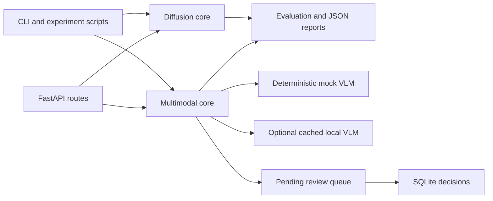

# Architecture

The diffusion core has independent continuous-noise demonstrations and a discrete masked-token path. The latter trains a small log-linear classifier and reconstructs tokens in configurable reverse iterations. The autoregressive bigram baseline uses the same synthetic training split.

The multimodal core decodes images, computes RGB features, extracts text from documents, and records source-linked findings. The default VLM backend is a deterministic pixel-statistics mock. A local Hugging Face image-text-to-text pipeline generates descriptions from a cached model. Model text is marked unverified and kept separate from rule-based severity. The review API stores a pending analysis and accepts one explicit human decision with cited sources.

The API uses JSON with bounded base64 binary inputs. `GET /health` is a minimal runtime check. The Docker image serves the API on port 8000. CI installs dependencies, runs pytest and a Lecture 8 benchmark, then builds the image.
